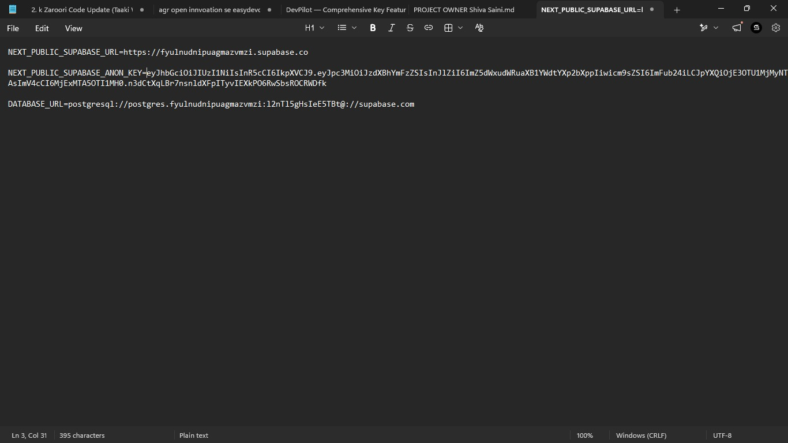

# TestBridge — MVP build prompt (paste into any AI coding agent)

## Context
You are building **TestBridge**, a hackathon MVP for Indian government hospitals.
Pitch: **"Your doctor stays the same. Only the test moves."**

Problem: a patient at an overloaded government hospital (Hospital A) waits ~14 days for a diagnostic test (MRI, CT, ultrasound). Nearby partner hospitals/labs (B–F) have spare slots this week. TestBridge lets A's doctor broadcast the test to nearby labs. The first lab to accept gets it. The patient gets an SMS (simulated). The lab uploads the report, which goes back to A's doctor. A's original queue slot is released to the next waiting patient.

All data is **synthetic**. There is no real auth and no real SMS. Show a "Synthetic demo data" banner on every page.

## Goal
Build a working end-to-end demo in a few hours. Keep it simple. Make it robust and the numbers real (computed from data). Skip polish.

## Stack (do not add more)
- Next.js (App Router, TypeScript) + Tailwind.
- Postgres. Use **PGlite** (embedded, zero install, stored in `./.data`) by default; use `pg` when `DATABASE_URL` is set. Same SQL for both.
- All tables and functions in schema `tb`.
- **Every state change is a plpgsql function** (`tb.create_referral`, `tb.accept_referral`, …) called from server actions. Never do multi-step writes from TypeScript.
- Live updates: client polls `/api/live?view=…` every 2s. No websockets needed.
- Demo login: a cookie `tb_user` holding a `demo_users.id`, chosen from a picker on `/`.
- Bilingual Hindi/English with a plain TS dictionary (no i18n library).

## Data model (minimal)
```
hospitals(id, code 'A'..'F', name, type govt|ppp, lat, lng, address_en, address_hi, phone)
test_types(id, code MRI|CT|USG|XRAY|ECHO, name_en, name_hi, prep_en, prep_hi)
hospital_tests(hospital_id, test_type_id, is_free, price_inr, current_wait_days)
demo_users(id, name, role doctor|lab|dho, hospital_id)
patients(id, display_name, phone, lang hi|en)
home_queue(id, hospital_id, test_type_id, patient_id, slot_at, status waiting|booked|held_backup|released|used, position)
referrals(id, code 'TB-0001', patient_id, from_hospital_id, doctor_id, test_type_id,
          priority p1|p2|p3, on_temp_medication, note, consent_recorded NOT NULL,
          max_distance_km, original_queue_id, original_slot_at, status, version,
          accepted_hospital_id, accepted_slot_at, accepted_at, patient_token unique,
          expires_at, test_done_at, created_at)
  UNIQUE INDEX on (patient_id, test_type_id) WHERE status not in (closed, expired, cancelled)
referral_recipients(referral_id, hospital_id, distance_km, score, score_breakdown jsonb, response accepted|lost_race|declined)
reports(id, referral_id UNIQUE, pdf bytea, reported_by_name, reg_no, uploaded_at)
messages(id, referral_id, patient_id, direction out|in, body, dedupe_key UNIQUE, created_at)
audit_log(id, at, actor_id, actor_role, referral_id, action, from_status, to_status, details jsonb)
  -- append-only: a trigger raises on UPDATE/DELETE
idempotency(key uuid PK, action, result jsonb)
demo_clock(offset interval)   -- tb.app_now() = now() + offset
```
Status flow: `open → accepted → patient_confirmed → arrived → test_done → report_sent → closed`. Side branches: `open → expired|cancelled`, `accepted → no_show → open`.

## Core rules (these are what the judges test)
1. **Atomic accept.** `tb.accept_referral(ref, hospital, user, slot_at, idem_key)`:
   - Insert the idem key; if it already exists, return the stored result.
   - `UPDATE referrals SET status='accepted' … WHERE id=ref AND status='open' AND expires_at > app_now() RETURNING *`.
   - 0 rows → return `{ok:false, reason:'already_accepted', by:'<hospital name>'}`, mark this recipient `lost_race`, **write an audit row for the losing attempt**.
   - Otherwise: mark A's original slot `held_backup`, insert the patient SMS (dedupe_key `accept:<code>`), write audit, return `{ok:true}`.
   - Proof: 20 parallel accepts → exactly 1 winner.
2. **Idempotency everywhere.** Each form/button sends a `crypto.randomUUID()` key. A double click or refresh never creates duplicates. Disable buttons while a request is in flight.
3. **Generic `tb.transition_referral(ref, from[], to, actor, idem)`** with the same pattern. Out-of-order clicks return a clear error.
4. **Slot release.** On `test_done`, A's original slot → `released`; the next `waiting` patient in A's home_queue gets it (`booked`) plus an SMS.
5. **Create referral** computes haversine distance in SQL. Recipients = hospitals offering the test within `max_distance_km`, excluding A. Score = P1 +100 / P2 +50 / P3 +10, temp meds +30, +2 per day waiting, −1 per km. Store the breakdown and show it.
6. **Audit log** for every action, including views and rejected attempts.
7. **No hardcoded stats.** Days saved = original_slot_date − test_done_date, computed.

## Screens
- `/` — login picker: Dr. Mehta (Hospital A), Lab B…F, DHO, Patient Phone. Admin drawer: **Reset demo**, **+1h / +6h / +24h** demo clock.
- `/doctor` — my referrals with live status chip, lab, date, days saved. Button: New referral.
- `/doctor/new` — patient (phone lookup), test (shows "your queue: 14 days"), P1/P2/P3, temp-med toggle, note, max km slider, **consent checkbox (required)**, live preview "N labs within X km offer MRI".
- `/r/[id]` — timeline, accepted lab card, report PDF viewer, score breakdown, audit tab, Print slip, Cancel / keep original date.
- `/r/[id]/slip` — printable: token, QR to the status page, lab address, date, prep in Hindi + English.
- `/doctor/queue` — A's home queue; show the held slot, then the release to the next patient.
- `/lab` — Incoming (sorted by score, breakdown, expiry countdown, slot picker, **Accept**/Decline, patient identity hidden until accepted); Today (Arrived / Test done / No-show); upload report (PDF + radiologist name + reg no).
- `/phone` — simulated phone: pick a patient, Hindi + English SMS bubbles, reply "1" → `patient_confirmed`.
- `/s/[token]` — public status page, no login, Hindi default, large step indicator, lab address, map link, prep checklist.
- `/audit` — live append-only log. `/dho` — KPI tiles computed from the DB (sent, accepted, median days saved, slots freed).

## Seed data
6 fictional hospitals in one district with real-looking lat/lng (2–30 km apart). A = overloaded (MRI wait 14 days). B, C within 15 km; D, E farther; F out of range. 5 test types with bilingual prep text (MRI: metal/pacemaker check; contrast CT: creatinine + fasting; USG abdomen: full bladder/fasting). Patient **Ramesh, 58, 9876500001**, MRI slot at D+14. Patient **Pooja** next in A's MRI waitlist. `tb.reset_demo()` restores all of this in under 5s with stable IDs.

## Demo flow that must work end to end
1. Dr. Mehta creates an MRI referral for Ramesh (P2, temp meds, 25 km, consent).
2. Lab B and Lab C both see it within 2s; both click Accept → one wins, the other sees "Already accepted by …"; the audit log shows both.
3. Phone panel shows the Hindi + English SMS with lab, date, token, prep and status link; Ramesh replies "1".
4. Lab marks Arrived → Test done → uploads PDF.
5. Doctor sees "Report ready — 14 days earlier" live; A's queue gives the released slot to Pooja, who gets an SMS.
6. Double click / refresh anywhere changes nothing. `/audit` explains every step.

## Build order (stop and verify after each)
1. DB schema + functions + seed + reset (test the race in SQL).
2. App shell: db client, session cookie, `/api/live` polling hook, header, login, demo controls.
3. Doctor screens. 4. Lab screens. 5. Phone + status page. 6. Audit + DHO.
7. Scripted end-to-end check (`npm run check:demo`), README with run/deploy steps.

## Out of scope (pitch as next steps)
Real auth + RLS by hospital, ABDM/ABHA, HMIS integration, DLT-registered SMS / WhatsApp, payments, transport, DICOM/PACS, offline PWA, LLM note drafting, maps.
